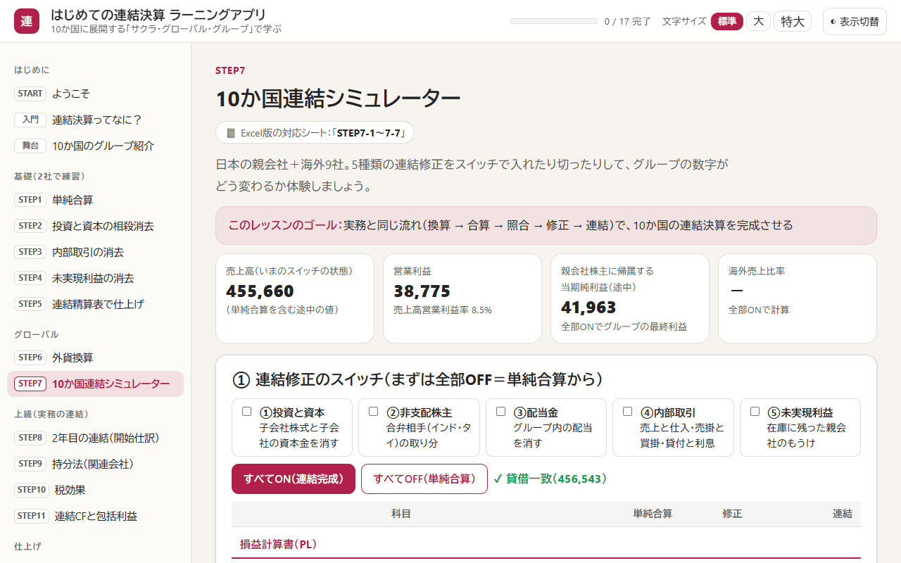
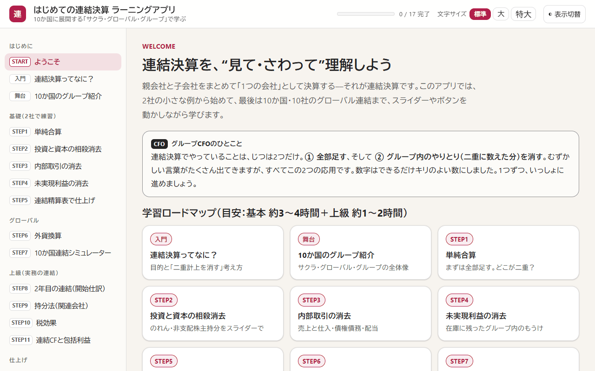

# はじめての連結決算 ラーニングツール

架空の10か国グループ「サクラ・グローバル・グループ」を舞台に、連結決算のしくみを“見て・さわって”学ぶ、インストール不要の教材です。日本の会計基準の考え方にもとづいています。

> **English summary:** A hands-on, beginner-friendly course (in Japanese) on consolidated financial statements, based on Japanese GAAP concepts. It consists of a single-file offline HTML app with a 10-country consolidation simulator, a 26-question quiz and a 49-term bilingual glossary, plus a 23-sheet Excel workbook that checks your answers instantly. All companies and figures are fictional.

  

| 項目 | 内容 |
|---|---|
| 学習時間の目安 | 基本 約3〜4時間＋上級 約1〜2時間 |
| 学習アプリ | 全17ページ（レッスン13、確認クイズ26問、用語集49語・英語つき） |
| Excel ワークブック | 23シート |

## 目次

- [この教材でわかること](#この教材でわかること)
- [すぐに始める](#すぐに始める)
- [収録ファイル](#収録ファイル)
- [カリキュラム](#カリキュラム)
- [学び方](#学び方)
- [動作環境](#動作環境)
- [よくある質問](#よくある質問)
- [注意事項](#注意事項)
- [利用について](#利用について)
- [このシリーズのほかの教材](#このシリーズのほかの教材)

## この教材でわかること

連結決算でやることは、大きく分けて次の2つだけです。

1. グループ各社の決算書を全部足す
2. グループの中のやりとり（二重に数えた分）を消す

この2つを軸に、親会社と子会社の2社の小さな例から始めて、最後は10か国・10社のグローバル連結まで進みます。

- 投資と資本の相殺消去、内部取引と未実現利益の消去、連結精算表の作り方
- 外貨換算と、5種類の連結修正をスイッチで入れたり切ったりして数字の変化を確かめる「10か国連結シミュレーター」
- 2年目の連結（開始仕訳）、持分法、税効果、連結キャッシュ・フロー計算書と包括利益

**こんな人に向いています**

- 経理・財務の仕事で、はじめて連結決算にかかわる人
- 簿記は学んだものの、連結の仕訳がイメージしにくい人
- 海外子会社がある会社で、外貨換算や持分法を復習したい人

## すぐに始める

インストールもアカウント登録もいりません。

1. このページの上にある緑色の **［Code］** ボタン → **［Download ZIP］** で、ファイル一式をダウンロードします。
2. ダウンロードした ZIP ファイルを展開します（Windows は右クリック → **［すべて展開］**、Mac はダブルクリック）。
3. **`連結決算ラーニングアプリ.html`** をダブルクリックすると、ブラウザで学習アプリが開きます。
4. **`連結決算ラーニングワークブック.xlsx`** を Excel で開きます。画面の上に「保護ビュー」の帯が出たら、**［編集を有効にする］** を押してください（押さないと答えを入力できません）。

> [!NOTE]
> GitHub の画面で `.html` ファイルをクリックすると、アプリではなく中身のコードが表示されます。アプリとして使うときは、ダウンロードしてから開いてください。1つのファイルだけ必要なときは、ファイルを開いて右上の **［Download raw file］**（下向き矢印のボタン）を押します。

## 収録ファイル

| ファイル | 内容 |
|---|---|
| [連結決算ラーニングアプリ.html](連結決算ラーニングアプリ.html) | 学習アプリ。全17ページ（レッスン13、確認クイズ26問、CFOの実務ノート、用語集49語）。10か国の連結シミュレーターつき |
| [連結決算ラーニングワークブック.xlsx](連結決算ラーニングワークブック.xlsx) | 実践ワークブック（23シート）。黄色いセルに答えを入れると、すぐに「○ 正解！」か「× もう一度」が出ます（確認テスト26問を含め、判定は120か所以上） |

## カリキュラム

| 区分 | レッスン |
|---|---|
| はじめに | 連結決算ってなに？、10か国のグループ紹介 |
| 基礎（2社で練習） | STEP1 単純合算、STEP2 投資と資本の相殺消去、STEP3 内部取引の消去、STEP4 未実現利益の消去、STEP5 連結精算表で仕上げ |
| グローバル | STEP6 外貨換算、STEP7 10か国連結シミュレーター |
| 上級（実務の連結） | STEP8 2年目の連結（開始仕訳）、STEP9 持分法（関連会社）、STEP10 税効果、STEP11 連結キャッシュ・フロー計算書と包括利益 |
| 仕上げ | 確認クイズ（26問）、CFOの実務ノート、用語集 |

そのほかの画面

 

  

## 学び方

1. 基礎の STEP1〜5 は、親会社（P社）と子会社（S社）の2社で練習します。
2. STEP6〜7 で、外貨の換算と、10か国・10社のグループ全体の連結に進みます。
3. 上級の STEP8〜11 で、2年目の連結・持分法・税効果・連結キャッシュ・フロー計算書まで学びます。
4. 各レッスンの見出しの下に、Excel の対応シート名が表示されます。同じ内容を Excel でも計算すると、理解が深まります。Excel は各シートの3行目にある「≡ 目次」「◀ 前」「次 ▶」で順番に移動できます。
5. 最後の確認クイズでは、まちがえた問題の振り返りと、まちがえた問題だけの解き直しができます。

> [!TIP]
> 学習アプリは、文字の大きさ（標準・大・特大）と、明るい表示・暗い表示を、画面右上で切り替えられます。

## 動作環境

| ファイル | 必要なもの | 補足 |
|---|---|---|
| 学習アプリ（`.html`） | Microsoft Edge、Google Chrome などのブラウザ | 1つのファイルで動き、外部のサーバーとは通信しません。進み具合は、使っているブラウザの中にだけ保存されます |
| ワークブック（`.xlsx`） | Microsoft Excel | マクロは使っていません |

2026年11月に、Windows 11 の Microsoft Edge で全ページの表示を、Microsoft 365 の Excel で全シートの計算（エラーが出ないこと）を確かめています。

## よくある質問

GitHub で HTML ファイルを開くと、文字（コード）ばかり表示されます

 
GitHub は HTML ファイルをアプリとして動かさず、中身のコードを表示します。<a href="#すぐに始める">すぐに始める</a>の手順でダウンロードしてから、ブラウザで開いてください。

Excel で答えを入力できません

 
インターネットから入手したファイルは「保護ビュー」（読み取り専用）で開きます。画面の上の帯にある［編集を有効にする］を押すと、入力できるようになります。

進み具合はどこに保存されますか？

 
アプリを開いたブラウザの中（localStorage）にだけ保存され、外部には送られません。別のパソコンや別のブラウザには引き継がれません。記録を消したいときは、ブラウザの閲覧データ（サイトデータ）を削除してください。

## 注意事項

- 学習のための教材です。会社・数字はすべて架空です。
- 日本の会計基準の考え方を、やさしく要約しています（細かい例外は省いています）。実務では、最新の会計基準を確かめ、公認会計士などの専門家に相談してください。

## 利用について

- 個人の学習や、勉強会・研修の教材として、自由に使ってください。自分用に内容を直して使ってもかまいません。
- ファイルを販売したり、有料の講座でそのまま配ったりする場合は、先に [Issues](https://github.com/rebelnaoto7/Consolidated-financial-statements-learning-tool/issues) でご相談ください。
- 正確さには注意して作っていますが、誤りがあるかもしれません。見つけたときは [Issues](https://github.com/rebelnaoto7/Consolidated-financial-statements-learning-tool/issues) で教えてください。

Microsoft、Windows、Microsoft 365、Microsoft Edge、Excel、Word、Power BI、Copilot は、Microsoft グループの商標です。この教材は、Microsoft が提供・承認したものではありません。そのほかの会社名・サービス名・製品名は、それぞれの会社の商標または登録商標です。

## このシリーズのほかの教材

| 教材 | ひとことで |
|---|---|
| [外資系コントローラー養成ツール](https://github.com/rebelnaoto7/Financial-Controller-Leaning-Tool) | 外資系企業の日本法人で、月次決算・本社報告・税務・資金繰りから Power BI まで |
| [M&Aアドバイザー養成ツール](https://github.com/rebelnaoto7/MA-advisor-learning-tool) | 売り手のFAとして、企業価値の評価・交渉・DD・契約・PMI を学ぶ |
| [日本株・米国株 分析ラーニングツール](https://github.com/rebelnaoto7/stock-analysis-learning-tool) | ファンダメンタル分析とテクニカル分析を、初級から超上級まで |
| [スモールビジネス起業・経営ツール](https://github.com/rebelnaoto7/small-business-starts-and-management-tool) | 小さなお店の開業から経営まで。自分の事業に使える計画用の Excel つき |
| [はじめてのセキュリティ入門](https://github.com/rebelnaoto7/cybersecurity-learningtool) | サイバー攻撃の手口と守り方を、試しながら学ぶ |
| [はじめての Power BI マーケティング分析](https://github.com/rebelnaoto7/Power-BI-and-Marketing) | マーケティングの数字の読み方と、Power BI でのダッシュボード作り |
